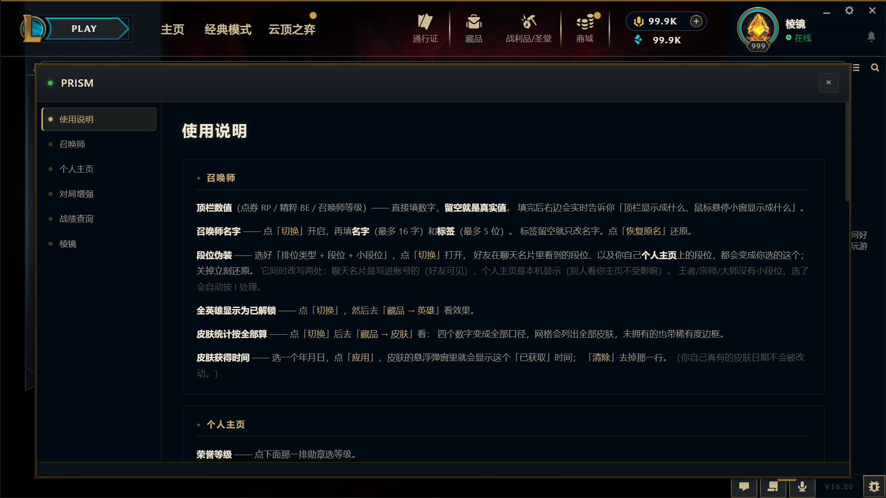
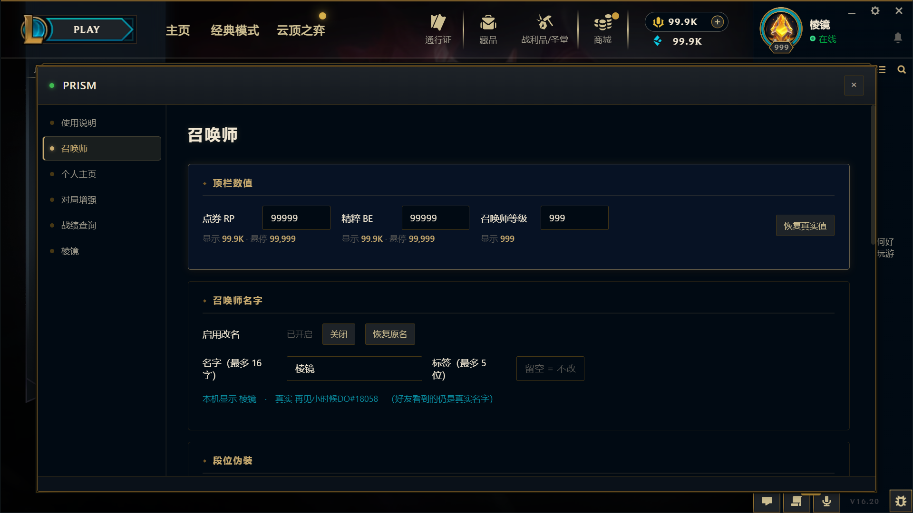
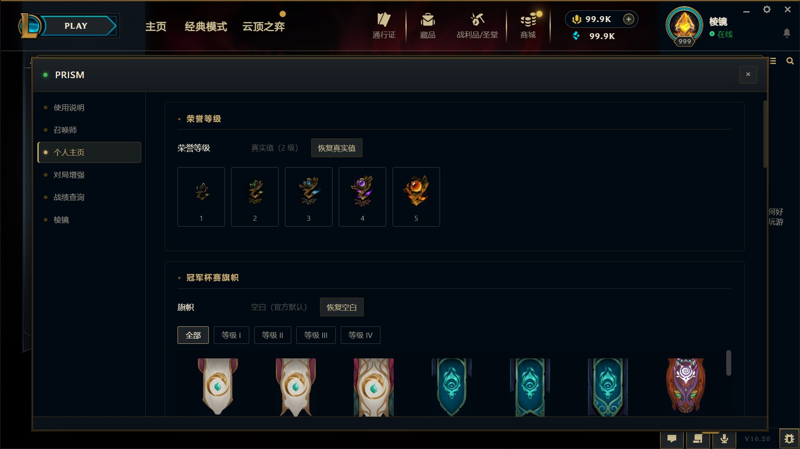
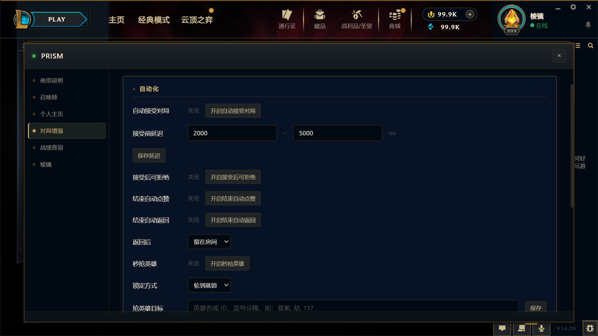
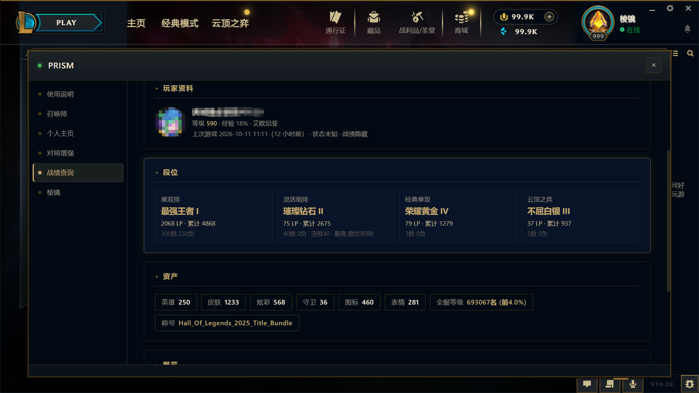
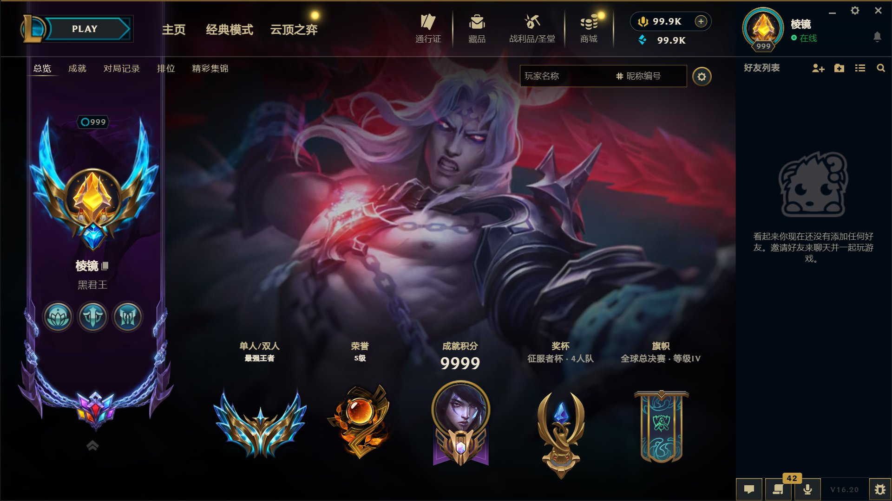
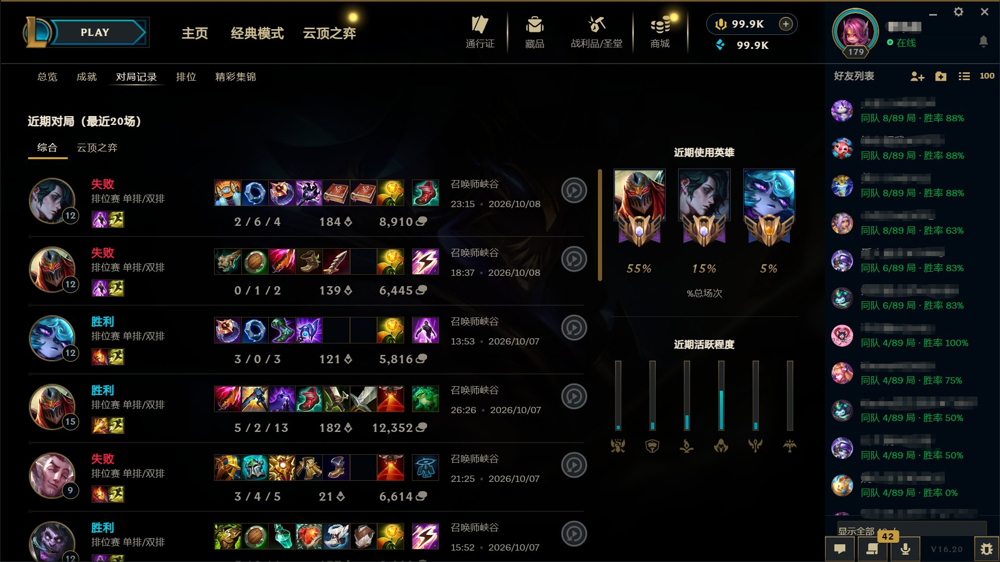

# PRISM · 英雄联盟国服客户端增强

<p align="center">
  
</p>

<h1 align="center">PRISM</h1>

<p align="center">英雄联盟国服客户端增强 · 只改你看到的，不碰游戏进程</p>

<p align="center">
  <a href="#-安装">快速开始</a> ·
  <a href="#-功能特性">功能特性</a> ·
  <a href="#-出问题了怎么办">常见问题</a> ·
  <a href="../../issues">报告问题</a>
</p>

---

> [!WARNING]
> **该项目大部分内容为 AI 产物，且处于开发初期，可能会出现各种 BUG**，有能力的可以根据源码自行修改，但**请勿用作商用**，一旦发现该项目将直接下线。
>
> 另外该项目在开发初期参考了很多 GitHub 上前辈开源项目，如：[WJZ-P/sona](https://github.com/WJZ-P/sona)；[hosnye/skinforge](https://github.com/hosnye/skinforge)；[Alban1911/Rose](https://github.com/Alban1911/Rose)；[LeagueToolkit/cslol-manager](https://github.com/LeagueToolkit/cslol-manager)；[PenguLoader/PenguLoader](https://github.com/PenguLoader/PenguLoader)。**感谢各位前辈的开源，没有各位前辈就不会有该项目，再次向各位前辈致敬！**

**PRISM 只改客户端大厅里你看到的东西**：召唤师信息、个人主页、身份标识、对局记录、战利品开箱……
**不往游戏里塞任何东西，不碰游戏进程，不影响对局公平性。**

<p align="center">
  
</p>

<p align="center"><em>▲ PRISM 面板 —— 进游戏后点大厅右下角的小图标就能打开，左侧是六个分页</em></p>

> **只想用、不想折腾**：直接去 [Releases](../../releases) 下载安装器，右键「以管理员身份运行」，跟着向导点下一步就行。
> 本仓库同时也提供**源码**，给想自己构建或阅读实现的人。

---

## 目录

- [安装](#-安装)
- [装好之后怎么用（每天都要）](#-装好之后怎么用每天都要)
- [功能特性](#-功能特性)
- [出问题了怎么办](#-出问题了怎么办)
- [怎么卸载](#️-怎么卸载)
- [注意事项](#️-注意事项)
- [许可](#-许可)

---

## 📦 安装

1. **右键安装程序 → 以管理员身份运行**。
2. **选择程序释放目录**。默认为 D 盘（没有 D 盘会自动往后顺延），程序会在这里建一个叫 `PRISM` 的文件夹。
3. **选择游戏安装目录**。不知道游戏装在哪的话：打开 WeGame，在左栏右键「英雄联盟」图标 → 「安装目录」，就能看到具体位置。
4. **首次运行会自动检测**你电脑里是否装过其他美化插件。如果有，会弹窗问你要不要搬到 PRISM 目录下一起用 —— **建议选「否」**，两个一起用容易互相干扰。
5. 等它提示**可以运行客户端了**，就可以正常启动客户端。

装完之后，**桌面上会多一个叫 `PRISM` 的图标**。

### 前置条件

- Windows 10 及以上（64 位）
- 英雄联盟国服客户端（腾讯 WeGame 版）

安装器自带运行环境，**不需要**另外装任何东西。

---

## 🚀 装好之后怎么用（每天都要）

顺序**一定要按这个来**：

```
① 双击桌面上的 PRISM
        ↓
② 等它弹出「已就绪，可以启动客户端了」
        ↓
③ 再打开英雄联盟
```

玩完关掉游戏，**PRISM 会自己退掉，不用管它**。

> ⚠️ **不先开 PRISM 就直接进游戏，功能不会生效。**

### 打开功能面板

进到客户端大厅后，点**右下角那个「上报 BUG」的小图标**，就能打开 PRISM 面板 —— 下面所有功能都在这个面板里。

面板左上角有个**小圆点**，是后端状态：**绿色 = 在线**，**灰色 = 没连上**（见[出问题了怎么办](#-出问题了怎么办)）。

---

## ✨ 功能特性

### 👤 召唤师

| 功能 | 说明 |
|------|------|
| **点券 / 精粹修改** | 任意修改顶栏显示的数值，实时生效 |
| **召唤师等级修改** | 不要超过 9999 |
| **召唤师名称修改** | 最多 16 字，**建议不超过 8 个字**（超了右上角会显示不全） |
| **标签修改** | 最多 5 位数 |
| **段位伪装** | 先选好想伪装的段位和等级 → 点「开启段位伪装」→ **好友可见** |
| **全英雄解锁** | 点对应开关生效，可到客户端藏品页检查 |
| **全皮肤解锁** | 同上 |

<p align="center">
  
</p>

<p align="center"><em>▲ 顶栏数值、召唤师名字与标签、段位伪装 —— 改完点「开启」才生效</em></p>

### 🏠 个人主页

| 功能 | 说明 |
|------|------|
| **荣誉等级** | 任意调整主页显示 |
| **成就等级 / 积分** | 同上 |
| **主页最高成就英雄** | 可以改成你想要的英雄 |
| **冠军杯赛旗帜 / 奖杯** | 可以添加**国服未实装**的旗帜和奖杯 ⚠️ 奖杯需要自己搭配底座 |

<p align="center">
  
</p>

<p align="center"><em>▲ 荣誉等级与冠军杯赛旗帜</em></p>

### 🎮 对局增强

| 功能 | 说明 |
|------|------|
| **自动接受对局** | 可以自己调「接受前延迟」 |
| **接受后拒绝** | 接受了对局之后再点拒绝 |
| **结束自动点赞** | 对局结束自动给所有人点赞 |
| **结束自动跳过等待** | 可选「直接排队」或「停留在组队界面」 |
| **秒抢英雄** | 需要提前在面板里填好目标英雄 |
| **自动 Ban 英雄** | 同上，也要提前填 |
| **界面元素隐藏** | 可隐藏首页云顶入口 / 首页顶栏右侧导航文字 / 赛事直播弹窗 |

<p align="center">
  
</p>

<p align="center"><em>▲ 一排自动化开关，每个都能单独配置</em></p>

### 🔍 战绩查询

- 输入**召唤师名称 + 尾标**就能查详细信息
- **隐藏战绩的召唤师也能查**
- 提示「后端离线」时，重新双击一次桌面的 PRISM 即可

<p align="center">
  
</p>

<p align="center"><em>▲ 段位、资产、称号一次看全（四种队列的段位分别列出）</em></p>

### 🔮 棱镜（复刻与扩展）

**复刻别人的主页**

> 简单说就是把你的个人主页**一比一复刻**成目标账号的主页 —— 没什么实际用途，**仅供娱乐**。

输入目标账号的召唤师名称 + 尾标即可，同时会：

- 把**好友栏**换成目标账号的「常玩好友」（⚠️ 只能拿到常玩好友，拿不到全部好友）
- 把**个人主页的对局记录**替换成目标账号的

<p align="center">
  
</p>

<p align="center"><em>▲ 复刻后的个人主页 —— 段位、荣誉、成就积分、奖杯、旗帜全部照搬</em></p>

<p align="center">
  
</p>

<p align="center"><em>▲ 连「对局记录」和右侧好友栏都会换成目标账号的</em></p>

**身份标识界面**

在个人主页界面点左侧头像，进入客户端**原生**的自定义身份标识界面 —— **五个页面都已覆盖**。

> ⚠️ **首次点开这个页面，客户端会自动重启一次**，之后不会再重启，是正常现象，不用惊慌。

- 所有可替换内容**已全部解锁**，但需要**手动开启「显示未拥有」按钮**；未拥有的内容会以客户端原生状态显示
- 更换方式和原生一样，支持原生搜索栏，点想要的头像 / 头像框 / 勋章 / 头衔 / 旗帜即可
- ⚠️ **勋章**解锁需要先在 PRISM 面板开启「成就解锁」并把等级拉高，才能显示全部勋章
- **右键点一下勋章**，可以选择要展示的等级（黑铁 — 王者）

**主页背景**

用客户端**原生的替换背景按钮**就行 —— 点按钮、搜索、替换。静态图和动态图会自动识别，**只要你不手动换，就会一直显示，好友可见**。

**战利品开箱**

战利品页面左下角那个**原生的问号按钮**已经换成了「**模拟开箱**」按钮。

- 可以按选择的宝箱爆率**模拟正常开箱流程**，目前预设了普通宝箱和紫色宝箱
- 开启后，点你**已有的**对应宝箱就能随意开箱
- ⚠️ **只是模拟**，**不消耗真实宝箱数量**，可以无限重复开，整个流程和真实开箱完全一致

### 🎨 其它

另外，同时制作了带**游戏内显示选人界面选中皮肤**的版本，但由于**涉及违反拳头协议**不采取开源政策，并且**小概率导致账号被 BAN**，如果真有需要的可以联系 QQ：**396469047**（注明来意）。

---

## ❓ 出问题了怎么办

**1. 战绩查询失败 / 面板左上角小圆点是灰色的**

后端有时会被网吧安全系统拦截。怎么处理：

- 看 PRISM 面板**左上角的小圆点**：**灰色 = 后端没连上**，**绿色 = 后端在线**
- 灰色时：**重新双击一次桌面上的 PRISM**
- 还是灰的：把**游戏和 WeGame 全部关掉**，再重新开一次 PRISM
- **家用电脑注意关掉 360 等第三方安全软件**，免得误杀后台

**2. 重装了游戏，或者把游戏挪到了别的盘**

**不用重装 PRISM** —— 下次开它自己会重新找到游戏。

**3. 遇到奇怪的毛病，想让管理员帮忙看**

把这两个日志文件发给他：

| 文件 | 位置 |
|------|------|
| `launcher.log` | 你装 PRISM 的那个文件夹里 |
| `server.log` | 同一个文件夹里的 `assets` 文件夹里 |

> ⚠️ **没有这两个文件，管理员也看不出问题出在哪。**

**4. 打开「身份标识」页面时客户端重启了**

正常现象 —— **只有第一次**会重启，之后不会。

---

## 🗑️ 怎么卸载

**方式一**：打开「控制面板 → 程序和功能」，找到 **PRISM**，右键卸载。

**方式二**：直接打开你装 PRISM 的那个文件夹，双击里面的 `unins000.exe`。

卸完之后，桌面上的 PRISM 图标会自己消失。

---

## ⚠️ 注意事项

1. **本程序只修改客户端里你看到的东西**，不往游戏里塞任何东西，也不会影响对局的公平性。
2. **每天都要按顺序来** —— 先双击桌面 PRISM 等「已就绪」，再开客户端。不先开它，功能不会生效。
3. **段位伪装、主页复刻这类只影响显示**，不会改动真实数据。
4. 遇到问题先看[出问题了怎么办](#-出问题了怎么办)，尤其是那两个日志文件。

---

## 📄 许可

本项目采用 **MIT** 许可，详见 [LICENSE](LICENSE)。

<br>

<div align="center">

**如果觉得好用，给个 ⭐ 支持一下**

</div>
